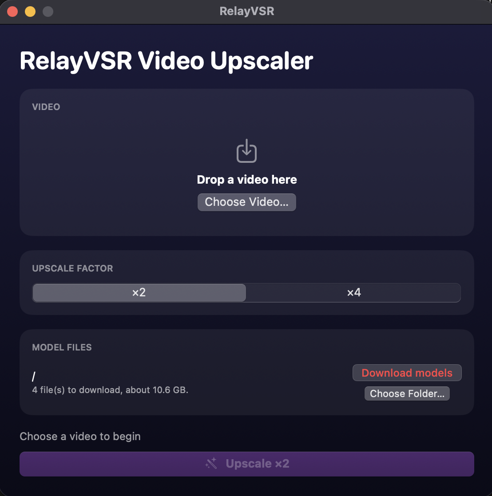
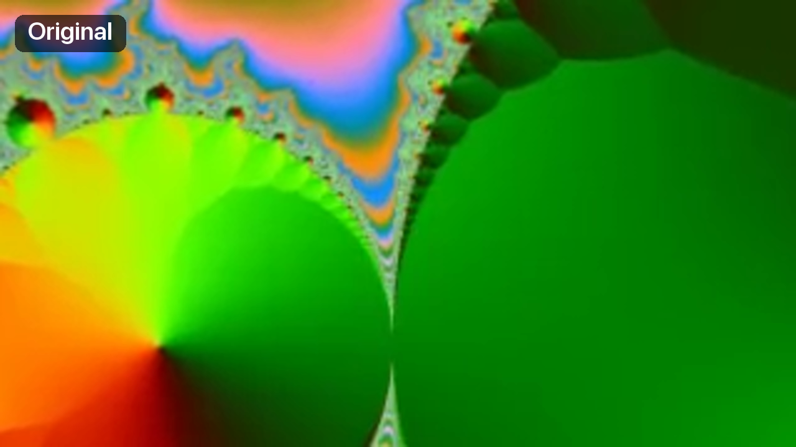
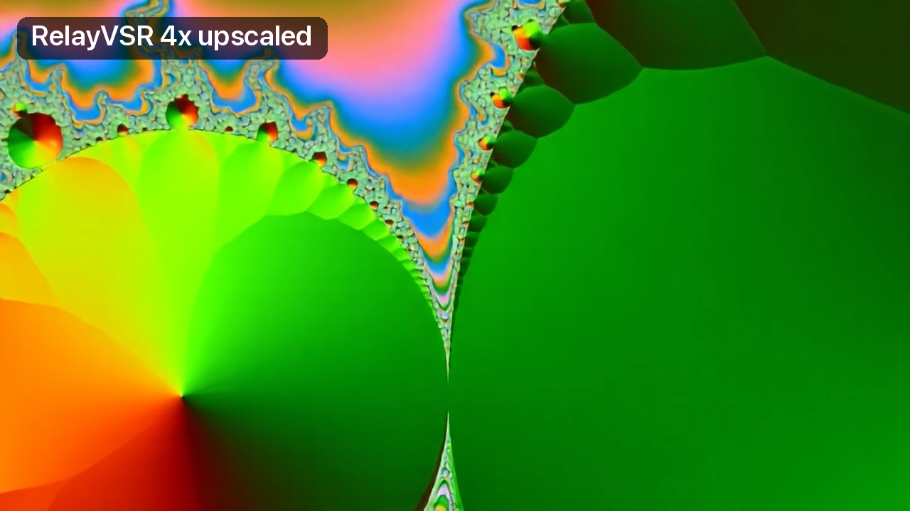

# RelayVSR Video Upscaler

A macOS app (Apple Silicon, macOS 14+) that upscales a video ×2 or ×4 with the
RelayVSR model, running on Comfy engine with the int8-Fast node in the background.

<p align="center"></p>

## What it does

A blurry 320×180 video, upscaled ×4 to 1280×720. The same frame from each:





## Install

Needs a Mac with Apple Silicon and macOS 14 or later. 32 GB of memory or more is
recommended for HD video.

1. Download the latest `RelayVSR-<version>.dmg` from the
   [Releases](../../releases) page, open it, and drag **RelayVSR** to **Applications**.
2. The app is not notarized by Apple, so the first time macOS blocks it. Open it once,
   then go to **System Settings ▸ Privacy & Security** and click **Open Anyway** next to
   RelayVSR. After that it opens normally.
3. Choose a folder for the model files and click **Download models** (about 10.6 GB).

Everything else, including the Comfy engine, is inside the app.

## Build from source

Only needed if you want to build the app yourself; the DMG above already contains
everything. You don't need ComfyUI installed: the build downloads what it needs.

Requires Xcode (or the Command Line Tools), [`uv`](https://docs.astral.sh/uv/) and git.

```bash
./scripts/build_app.sh       # builds build/RelayVSR.app
./scripts/make_dmg.sh        # optional: build/RelayVSR-<version>.dmg
```

The first build takes a few minutes and downloads about 1 GB: `scripts/build_engine.sh`
stages the engine that goes inside the app, in `build/engine-stage`. Later builds reuse
it; delete that folder to stage it again. The engine is:

- a standalone Python 3.13 (fetched by `uv`), with PyTorch 2.14.1 and ComfyUI's
  requirements;
- [ComfyUI](https://github.com/comfyanonymous/ComfyUI) at a pinned commit of its main
  branch (the RelayVSR nodes are not in a ComfyUI release yet);
- the [ComfyUI-AppleSilicon-int8-Fast](https://github.com/Illuminus7/ComfyUI-AppleSilicon-int8-Fast)
  node at a pinned commit (release 1.2.0);
- the app's own small add-ons in `EngineAddons/`, copied in when the app is built. Today
  that is one: it labels the upscaled video as BT.709, like the original, instead of
  ComfyUI's sRGB label, which Apple's players show noticeably darker.

The pinned versions are at the top of `scripts/build_engine.sh`. To build from local
copies instead, set `COMFY_SRC` to a ComfyUI folder (and `INT8_SRC` to the int8-Fast
folder, if it isn't in that ComfyUI's `custom_nodes`).

### Signing

By default the app is signed ad-hoc, which runs on the Mac that built it; other Macs
block it. To share it, sign with a Developer ID and notarize:

```bash
SIGN_IDENTITY="Developer ID Application: Your Name (TEAMID)" NOTARY_PROFILE=relayvsr ./scripts/build_app.sh
```

Create the notary profile once with `xcrun notarytool store-credentials relayvsr`.
The engine's binaries are signed with the hardened runtime and the exceptions in
`Resources/engine.entitlements`. This path has not been tested yet.

## How it works

1. **Video**: choose or drop an MP4, MOV or M4V. The file is checked when it is
   chosen. The result is always saved as `<name> upscaled.mp4` in the same folder
   (a number is added if the name is taken). The video is never re-encoded after
   upscaling; audio MP4 players don't expect, such as the PCM in many MOV files, is
   converted to AAC.
2. **Models**: the four RelayVSR files (×2 and ×4) come from
   [Comfy-Org/RelayVSR](https://huggingface.co/Comfy-Org/RelayVSR) and are stored in a
   folder you pick, in ComfyUI's layout (`diffusion_models/`, `vae/`). An existing ComfyUI
   `models` folder works as-is; picking its `diffusion_models` or `vae` folder, or the
   ComfyUI folder above it, is corrected automatically.
3. **Downloads**: four parts per file at the same time, resumable after Cancel or a quit.
   Parts are named with the file's hash, so parts of an older upload are never mixed in.
   The joined file is checked against Hugging Face's SHA-256 before it is used, and free
   space is checked first.
4. **Upscaling**: the video is upscaled in parts that fit in memory. Each part is one
   ComfyUI run of ComfyUI's standard RelayVSR video upscale graph, plus a Trim Video
   node. A part that runs out of memory is retried at half the size. The parts are then
   joined without re-encoding, with the original audio.
5. **Engine**: the bundled ComfyUI runs headless on a free localhost port. It stays
   loaded for five minutes after a job so the next one starts quickly, then stops.
   Only one copy of the app runs at a time; leftovers from a crash (engine processes,
   work files, half-joined downloads) are cleared at the next launch.

### Measured on a 48 GB Mac

Whole jobs, from pressing Upscale to the saved file:

| Input | Factor | Output | Frames | Time |
|---|---|---|---|---|
| 512×768 | ×4 | 2048×3072 | 362 | 6 min 1 s |
| 1920×1080 | ×2 | 3840×2160 | 60 | 1 min 25 s |
| 1920×1080 | ×4 | 7680×4320 | 8 | 1 min 2 s |

The first video took 5 min 59 s in ComfyUI itself, with the same models and int8-Fast.

## Logs and temporary files

- The app writes no log files. The engine's output is kept as a short tail in memory
  and shown only in error messages.
- Model downloads are written as parts next to the final file, then joined.
- During a job, the video is hard-linked (or copied, if it is on another volume) into
  `~/Library/Application Support/RelayVSR/input`, and each upscaled part is written to
  `…/output`. All of these are deleted when the job ends.
- ComfyUI may keep small preview files in `…/temp`; the app clears that folder at launch.

## Requirements

- To build: Xcode or the Command Line Tools, `uv` and git (see Build from source).
- To run: macOS 14 on Apple Silicon. About 10.6 GB of model files, downloaded on
  first use to the folder you choose.

## License

The app's own code (everything in this repository) is under the [MIT License](LICENSE).

The built app bundles other software under its own licenses, and sharing the built app
means following them: ComfyUI (GPL-3.0), the ComfyUI-AppleSilicon-int8-Fast node (MIT),
PyTorch (BSD-3-Clause), Python (PSF License) and the Python packages ComfyUI installs.
The RelayVSR model files are not part of the app; they are downloaded from Hugging Face
under their own terms.
